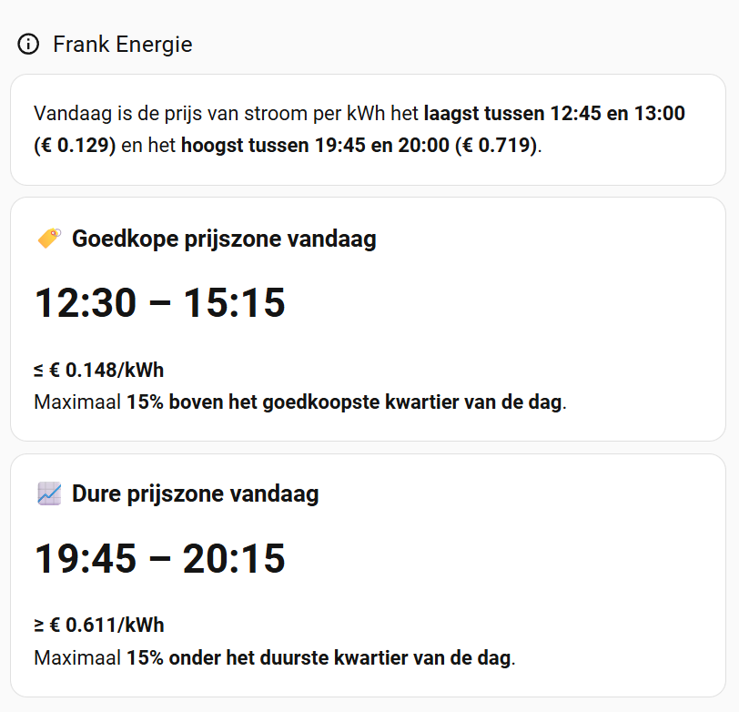
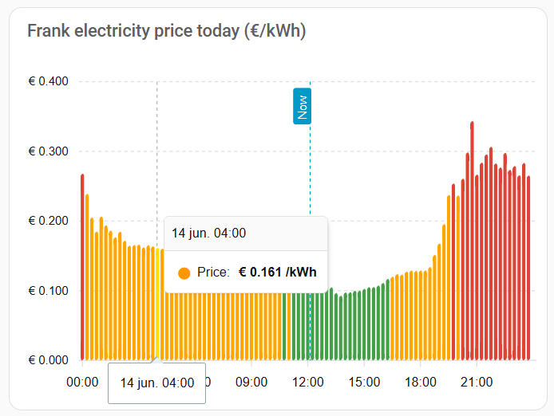

# Frank Energie Kwartierprijzen voor Home Assistant

🇳🇱 Nederlands | [🇬🇧 English](README_EN.md)

[](https://github.com/hacs/default)
[](https://github.com/Bennie-JC/ha-frank-quarter-prices/releases/latest)
<!-- Installatiebadge: tijdelijk uitgeschakeld. frank_quarter_prices staat nog niet in
     analytics.home-assistant.io/custom_integrations.json, waardoor de badge "no result"
     toont. Zet de regel hieronder terug zodra de integratie daar wél in staat. -->
<!--  -->
[](https://github.com/Bennie-JC/ha-frank-quarter-prices/actions/workflows/hacs.yml)
[](https://github.com/Bennie-JC/ha-frank-quarter-prices/actions/workflows/hassfest.yml)
[](https://github.com/Bennie-JC/ha-frank-quarter-prices/stargazers)
[](https://github.com/Bennie-JC/ha-frank-quarter-prices/issues)
[](https://github.com/Bennie-JC/ha-frank-quarter-prices/commits/main)
[](LICENSE)
[](https://www.home-assistant.io/)
[](https://github.com/Bennie-JC/ha-frank-quarter-prices)

**Frank Energie Kwartierprijzen** is een Home Assistant **custom integratie** voor de **dynamische stroomprijzen van Frank Energie** op **15-minutenbasis** — de ruwe kwartierresolutie zoals Frank Energie die zelf publiceert, niet een uurgemiddelde.

De integratie levert de volledige kwartierprijzen voor **vandaag** en, zodra gepubliceerd, **morgen**, samen met de actuele afnameprijs, de actuele terugleverprijs, het goedkoopste en duurste prijsvenster van de dag en de instelbare **goedkope en dure prijszone** van vandaag. De sensoren zijn direct bruikbaar in **dashboards**, **automatiseringen**, voor **thuisbatterijen** en in een eigen **Energy Management Systeem (EMS)** — geschikt voor wie stuurt op **dynamische energieprijzen**.

De integratie is opgenomen in **HACS Default** en dus rechtstreeks doorzoekbaar en installeerbaar via HACS, zonder een aangepaste repository toe te voegen.

> Deze integratie leest de openbare Frank Energie GraphQL API uit en levert de prijzen van vandaag en morgen, de huidige prijs en het goedkoopste en duurste prijsvenster van elke dag. De actuele kwartierprijs wordt op iedere echte kwartiergrens (`:00`/`:15`/`:30`/`:45`) opnieuw bepaald; de dagreeksen zelf worden lokaal gecachet en alleen opgehaald wanneer ze ontbreken. De volledige prijsreeksen zijn beschikbaar als sensorattributen voor je eigen EMS-logica, batterijsturing en dynamische energietarieven.

---

## Inhoudsopgave

- [Functies](#functies)
- [Installatie](#installatie)
  - [HACS-installatie (aanbevolen)](#hacs-installatie-aanbevolen)
  - [Handmatige installatie](#handmatige-installatie)
- [Configuratie](#configuratie)
  - [Instellingen](#instellingen)
- [Aangemaakte sensoren](#aangemaakte-sensoren)
  - [Sensoroverzicht](#sensoroverzicht)
  - [Sensoren goedkoopste / duurste prijsvenster](#sensoren-goedkoopste--duurste-prijsvenster)
  - [Prijszones (goedkoop / duur)](#prijszones-goedkoop--duur)
  - [Optimale periodes (goedkoop / duur)](#optimale-periodes-goedkoop--duur)
  - [Attributen van prijsblokken](#attributen-van-prijsblokken)
- [Home Assistant Energy Dashboard](#home-assistant-energy-dashboard)
  - [Netafname (verbruik)](#netafname-verbruik)
  - [Teruglevering aan het net](#teruglevering-aan-het-net)
- [Prijszone-dashboard](#prijszone-dashboard)
- [Verwerking van prijzen voor morgen](#verwerking-van-prijzen-voor-morgen)
- [GraphQL API-bron](#graphql-api-bron)
- [ApexCharts-dashboard](#apexcharts-dashboard)
- [EMS-integratievoorbeelden](#ems-integratievoorbeelden)
- [Voorbeeld Home Assistant-templates](#voorbeeld-home-assistant-templates)
- [Probleemoplossing](#probleemoplossing)
- [Veelgestelde vragen](#veelgestelde-vragen)
- [Bijdragen](#bijdragen)
- [Disclaimer](#disclaimer)
- [Licentie](#licentie)

---

## Functies

- ⚡ **Kwartierprijzen** — volledige marktprijsresolutie van 15 minuten (met automatische terugval naar 60-minutendata wanneer dat is wat Frank Energie publiceert).
- 📅 **Vandaag & morgen** — beide dagen worden automatisch opgehaald en lokaal gecachet; de prijzen voor morgen verschijnen zodra ze gepubliceerd zijn (doorgaans tussen 13:00 en 14:00 markttijd).
- 💶 **Sensor voor de huidige prijs** — het actieve prijsblok, met de volledige prijsopbouw als attributen.
- 📉 Sensoren voor het **goedkoopste en duurste** prijsvenster (prijs + starttijd) voor de **volledige dag**, zowel vandaag als morgen.
- 🏷️ **Prijszones** — de langste aaneengesloten goedkope en dure periode van vandaag, met start- en eindsensoren (echte tijdstempels) en binaire sensoren die aangeven of je nu ín die periode zit. De marges zijn instelbaar (standaard 15%).
- 🎯 **Optimale periodes** (optioneel, standaard uit) — de goedkoopste of duurste aaneengesloten periode van **precies** de duur die jij instelt (bijvoorbeeld 120 minuten), voor vandaag én morgen. Ideaal om een wasmachine, warmtepomp of thuisbatterij op het beste moment te laten draaien.
- 🗂️ **Volledige prijsreeksen** voor vandaag en morgen als sensorattributen — ideaal als databron voor een EMS.
- 📦 **HACS Default** — direct doorzoekbaar en installeerbaar binnen HACS, geen aangepaste repository nodig.
- 🔁 **Robuuste updates** — als de data voor morgen nog niet beschikbaar is, breekt dit de integratie nooit; de sensoren blijven simpelweg onbeschikbaar tot publicatie.
- 🌍 **NL als standaard met optionele BE-ondersteuning** via de `x-country`-header.
- 🛠️ **Diagnostiek-ondersteuning** voor eenvoudige probleemoplossing (geheimen worden weggelaten).
- 🧩 Gebouwd op Home Assistant's `DataUpdateCoordinator` en config entries, volgens de moderne best practices (2025+).

---

## Installatie

[](https://my.home-assistant.io/redirect/hacs_repository/?owner=Bennie-JC&repository=ha-frank-quarter-prices&category=integration)

Frank Quarter Prices is beschikbaar als **HACS Default** repository.

1. Klik op de knop hierboven om de integratie in HACS te openen.
2. Installeer **Frank Quarter Prices** via HACS.
3. Herstart Home Assistant indien HACS daarom vraagt.
4. Voeg daarna de integratie toe via **Instellingen → Apparaten & diensten → Integratie toevoegen → Frank Quarter Prices**.

> De knop hierboven opent de repository direct in **HACS**, voor het **installeren of bijwerken** van de custom integratie. Om de integratie daarna te **configureren**, gebruik je de aparte "Integratie toevoegen"-knop bij [Configuratie](#configuratie).

### HACS-installatie (aanbevolen)

Deze integratie is opgenomen in **HACS Default** en is direct doorzoekbaar in HACS — een aangepaste repository toevoegen is niet nodig.

1. Zorg dat [HACS](https://hacs.xyz/) geïnstalleerd is.
2. Ga in Home Assistant naar **HACS → Integraties**.
3. Zoek naar **Frank Quarter Prices** en klik op **Downloaden**.
4. **Herstart Home Assistant**.

> Zie je de integratie nog niet direct staan? Herlaad de HACS-cache (**HACS → ⋮ rechtsboven → HACS opnieuw laden**). Als fallback kun je de repository ook tijdelijk handmatig toevoegen via **HACS → Integraties → ⋮ (rechtsboven) → Aangepaste repositories** met de URL `https://github.com/Bennie-JC/ha-frank-quarter-prices` (categorie **Integratie**).

### Handmatige installatie

1. Download de nieuwste release van de [releases-pagina](https://github.com/Bennie-JC/ha-frank-quarter-prices/releases).
2. Kopieer de map `custom_components/frank_quarter_prices` naar de map `config/custom_components/` van je Home Assistant:
   ```
   config/
   └── custom_components/
       └── frank_quarter_prices/
           ├── __init__.py
           ├── manifest.json
           ├── ...
   ```
3. **Herstart Home Assistant**.

---

## Configuratie

Installeer **Frank Quarter Prices** eerst via HACS. Daarna kun je de integratie direct toevoegen met onderstaande knop:

[](https://my.home-assistant.io/redirect/integration/?domain=frank_quarter_prices)

Of handmatig:

1. Ga naar **Instellingen → Apparaten & diensten → Integratie toevoegen**.
2. Zoek naar **Frank Quarter Prices**.
3. Volg de stappen en bevestig.

Bij het toevoegen kies je alleen het **land** (NL of BE). Er is geen account, token of wachtwoord nodig.

Alle entiteiten vallen onder één apparaat met de naam **Frank**. De integratie gebruikt entity-ID's in de vorm `sensor.frank_<naam>`, bijvoorbeeld `sensor.frank_current_price`. De voorbeelden in deze README gebruiken die ID's rechtstreeks — controleer ze op je eigen systeem via **Ontwikkelaarshulpmiddelen → Statussen**.

### Instellingen

Alle overige instellingen wijzig je achteraf via:

```text
Instellingen → Apparaten & diensten → Frank Quarter Prices → Configureren
```

| Instelling | Standaard | Bereik | Betekenis |
| --- | --- | --- | --- |
| **Teruglevercorrectie** | `0.0 EUR/kWh` | −1.0 … 1.0, stap 0.001 | Bedrag dat bij de marktprijs wordt opgeteld om je terugleverprijs te schatten. Positief = extra vergoeding, negatief = inhouding. |
| **21% btw toepassen op terugleverprijs** | uit | aan/uit | Rekent de terugleverprijs inclusief 21% btw, toegepast op de marktprijs plús de teruglevercorrectie. |
| **Marge goedkope prijszone** | `15%` | 0 … 49%, stap 1% | Welk deel van het dagelijkse prijsverschil, gerekend vanaf het goedkoopste kwartier, nog als goedkoop telt. |
| **Marge dure prijszone** | `15%` | 0 … 49%, stap 1% | Welk deel van het dagelijkse prijsverschil, gerekend vanaf het duurste kwartier, nog als duur telt. |
| **Optimale goedkope periode inschakelen** | uit | aan/uit | Maakt de entiteiten voor de goedkoopste aaneengesloten periode beschikbaar. Nooit ingeschakeld geweest? Dan worden ze niet aangemaakt. Schakel je de functie later weer uit, dan blijven eerder aangemaakte entiteiten bestaan als `unavailable`, zodat entity-ID's en aanpassingen behouden blijven. |
| **Duur optimale goedkope periode** | `120 min` | 15 … 720 min, stap 15 | De exacte lengte van die periode. Alleen hele minuten op de stap van 15; andere waarden worden geweigerd. |
| **Optimale dure periode inschakelen** | uit | aan/uit | Idem voor de duurste aaneengesloten periode: nooit ingeschakeld betekent geen entiteiten, later uitschakelen laat ze als `unavailable` staan. |
| **Duur optimale dure periode** | `120 min` | 15 … 720 min, stap 15 | De exacte lengte van die periode. Alleen hele minuten op de stap van 15; andere waarden worden geweigerd. |

Het formulier is bewust één overzichtelijke lijst in drie logische groepen: eerst de terugleverinstellingen, dan de twee zonemarges, dan de twee optionele optimale periodes met elk hun eigen duur er direct onder.

Beide zonemarges staan **standaard op 15%** en zijn vrij instelbaar tussen 0 en 49%; 15% is dus geen vaste regel maar alleen de startwaarde.

De marge is een percentage van het **prijsverschil van de dag zelf** — het verschil tussen het duurste en het goedkoopste kwartier — en niet van de prijs in euro's. Bij de standaardmarge van 15% telt een kwartier mee voor de goedkope zone zolang het niet meer dan 15% van dat dagelijkse prijsverschil boven de laagste prijs ligt. De **langste aaneengesloten reeks** van die kwartieren vormt de zone. Voor de dure zone geldt hetzelfde spiegelbeeldig, gerekend vanaf de duurste kwartierprijs.

Het maximum is 49% en niet 50%, zodat de goedkope en de dure zone elkaar nooit kunnen overlappen: samen blijven ze altijd onder de 100% van het dagbereik, dus geen enkel kwartier kan tegelijk goedkoop én duur zijn.

Wijzig je een marge, dan volgen de zonesensoren, de binaire sensoren en het dashboard automatisch. Home Assistant herlaadt daarbij de integratie — net zoals bij elke andere optiewijziging — waarna de prijzen van vandaag (en na 12:00 markttijd ook die van morgen) één keer opnieuw worden opgehaald. De zoneberekening zelf is puur lokaal rekenwerk en doet geen eigen aanvraag.

> Bestaande installaties hoeven niets te doen. Een configuratie zonder deze instellingen gebruikt automatisch de standaardwaarden; opnieuw toevoegen is niet nodig.

---

## Aangemaakte sensoren

De integratie maakt standaard exact **19 entiteiten** aan, afgestemd op gebruik binnen een EMS. Schakel je een van de [optimale periodes](#optimale-periodes-goedkoop--duur) in, dan komen daar drie entiteiten per functie bij: 22 met één functie aan, 25 met beide. Schakel je zo'n functie daarna weer uit, dan blijven die entiteiten bestaan maar worden ze `unavailable` — zie [Optimale periodes](#optimale-periodes-goedkoop--duur).

Voor elke dag vraagt de integratie **alle** prijsblokken voor stroom op bij Frank Energie (lokaal 00:00 → 24:00) en bepaalt het enige goedkoopste en het enige duurste blok van die **volledige dag**, op de ruwe resolutie die Frank teruggeeft (15 minuten of per uur). Er wordt geen filtering op de komende 24/48 uur, geen filtering op alleen de huidige tijd, geen filtering op alleen de toekomst en geen uurgemiddelde toegepast.

### Sensoroverzicht

| Entiteit | Beschrijving | Status | Eenheid |
| --- | --- | --- | --- |
| `sensor.frank_current_price` | Dynamische afnameprijs ("marktprijs+") van het op dit moment actieve blok | `market_price + market_price_tax + sourcing_markup_price` | EUR/kWh |
| `sensor.frank_current_return_price` | Geschatte actuele terugleverprijs voor stroom, op basis van het geverifieerde Frank-marktprijsveld en de ingestelde teruglevercorrectie | berekende prijs | EUR/kWh |
| `sensor.frank_cheapest_today` | Goedkoopste blokprijs van de volledige dag vandaag | `total_price_eur_kwh` | EUR/kWh |
| `sensor.frank_cheapest_time_today` | Starttijd van het goedkoopste blok vandaag | `HH:MM` | — |
| `sensor.frank_most_expensive_today` | Duurste blokprijs van de volledige dag vandaag | `total_price_eur_kwh` | EUR/kWh |
| `sensor.frank_most_expensive_time_today` | Starttijd van het duurste blok vandaag | `HH:MM` | — |
| `sensor.frank_cheapest_tomorrow` | Goedkoopste blokprijs van de volledige dag morgen | `total_price_eur_kwh` | EUR/kWh |
| `sensor.frank_cheapest_time_tomorrow` | Starttijd van het goedkoopste blok morgen | `HH:MM` | — |
| `sensor.frank_most_expensive_tomorrow` | Duurste blokprijs van de volledige dag morgen | `total_price_eur_kwh` | EUR/kWh |
| `sensor.frank_most_expensive_time_tomorrow` | Starttijd van het duurste blok morgen | `HH:MM` | — |
| `sensor.frank_cheap_zone_start_today` | Start van de goedkope prijszone vandaag | tijdstempel | — |
| `sensor.frank_cheap_zone_end_today` | Einde van de goedkope prijszone vandaag | tijdstempel | — |
| `sensor.frank_expensive_zone_start_today` | Start van de dure prijszone vandaag | tijdstempel | — |
| `sensor.frank_expensive_zone_end_today` | Einde van de dure prijszone vandaag | tijdstempel | — |
| `sensor.frank_prices_today` | Aantal prijsblokken vandaag (volledige reeks in attributen) | aantal | blokken |
| `sensor.frank_prices_tomorrow` | Aantal prijsblokken morgen (volledige reeks in attributen) | aantal | blokken |
| `binary_sensor.frank_cheap_period` | Of het nú goedkope stroom is (binnen de goedkope prijszone) | aan/uit | — |
| `binary_sensor.frank_expensive_period` | Of het nú dure stroom is (binnen de dure prijszone) | aan/uit | — |
| `binary_sensor.frank_tomorrow_prices_available` | Of de prijzen voor morgen gepubliceerd zijn | aan/uit | — |

### Sensoren goedkoopste / duurste prijsvenster

Voor elke dag is er een bij elkaar horend paar sensoren, opgebouwd uit hetzelfde blok:

**Prijssensor** (`sensor.frank_cheapest_today`, `sensor.frank_most_expensive_today` en de `*_tomorrow`-varianten):

- **Status:** de `total_price_eur_kwh` van het blok (EUR/kWh).
- **Attributen:**
  - `time` — de lokale **start**tijd van het blok als `"HH:MM"` (bijv. `"19:45"`),
  - `timestamp` — de start van het blok als lokale ISO-datumtijd,
  - `end_timestamp` — het einde van het blok als lokale ISO-datumtijd,
  - `duration_minutes` — de bloklengte (15 of 60),
  - `full_block` — de volledige prijsopbouw.

**Tijdsensor** (`sensor.frank_cheapest_time_today`, `sensor.frank_most_expensive_time_today` en de `*_tomorrow`-varianten):

- **Status:** de lokale **start**tijd van het blok als `"HH:MM"` (bijv. `"13:45"`).
- **Attributen:** `price`, `timestamp`, `end_timestamp`, `duration_minutes`, `full_block`.

Voorbeeld:

```text
sensor.frank_cheapest_today = 0.0735           # EUR/kWh
  attributes:
    time: "19:45"
    timestamp: "2026-06-13T19:45:00+02:00"
    end_timestamp: "2026-06-13T20:00:00+02:00"
    duration_minutes: 15

sensor.frank_cheapest_time_today = "19:45"
  attributes:
    price: 0.0735
    timestamp: "2026-06-13T19:45:00+02:00"
    end_timestamp: "2026-06-13T20:00:00+02:00"
    duration_minutes: 15
```

De `*_tomorrow`-sensoren blijven **onbeschikbaar** totdat Frank Energie de prijzen voor morgen publiceert.

### Prijszones (goedkoop / duur)

Waar de sensoren hierboven het énkele goedkoopste en duurste kwartier aanwijzen, geven de prijszones de **hele periode** waarin stroom goedkoop respectievelijk duur is. Dat is wat je nodig hebt om een boiler, wasmachine of thuisbatterij een blok achter elkaar te laten draaien.

**Hoe de zone wordt bepaald:**

1. De integratie bepaalt eerst het **prijsverschil van de volledige dag**: de duurste kwartierprijs min de goedkoopste.
2. De ingestelde marge — standaard **15%** — is een percentage van dát verschil, gerekend vanaf de betreffende uiterste prijs:

   ```text
   dagverschil      = hoogste prijs − laagste prijs
   goedkope drempel = laagste prijs + dagverschil × marge%
   dure drempel     = hoogste prijs − dagverschil × marge%
   ```

   Bijvoorbeeld: laagste prijs `0.10`, hoogste prijs `0.30`, dus een dagverschil van `0.20`. Bij 15% ligt de goedkope drempel op `0.10 + 0.20 × 0,15 = 0.13` en de dure drempel op `0.30 − 0.20 × 0,15 = 0.27`.

3. Elk kwartier dat aan die drempel voldoet, is een kandidaat.
4. De zone is de **langste aaneengesloten reeks** kandidaten. Losse goedkope kwartieren elders op de dag worden dus niet meegetrokken: als 03:00–03:15 goedkoop is en 12:30–15:15 aaneengesloten goedkoop is, dan is de zone `12:30–15:15` en niet `03:00–15:15`.
5. Zijn twee reeksen precies even lang, dan wint de **vroegste**.

Omdat de marge het dagbereik als maatstaf gebruikt en maximaal 49% is, liggen de twee drempels altijd uit elkaar. Een kwartier kan dus nooit tegelijk als goedkoop én als duur worden aangemerkt, en de twee zones kunnen elkaar niet overlappen.

De berekening gebruikt de echte begin- en eindtijdstempels van de prijsblokken, dus de dagen met zomer-/wintertijdovergang (92 of 100 kwartieren) werken net zo goed als een gewone dag van 96 kwartieren.

**Een prijszone wordt alleen gepubliceerd voor een volledige dag.** Een zone doet een uitspraak over de héle dag ("het goedkoopste aaneengesloten blok van vandaag"); dat kun je niet beantwoorden met alleen de ochtend. Zolang de prijsreeks van vandaag onvolledig is — bijvoorbeeld vlak na een herstart, of wanneer Frank de dag in delen publiceert — blijven alle zes de zone-entiteiten **onbeschikbaar** in plaats van een misleidende zone uit een halve dag te tonen. Zodra de dag compleet is, verschijnen ze vanzelf. Is een volledige dag eenmaal bekend, dan blijven de zones ook tijdens een storing van de Frank API gewoon werken vanuit die gecachete dag.

Volledigheid wordt gemeten aan de werkelijke **marktdagrand** (van middernacht tot middernacht in de tijdzone van de markt: `Europe/Amsterdam` voor NL en `Europe/Brussels` voor BE), niet aan een vast aantal blokken — daarom kloppen ook de 92- en 100-kwartierdagen rond de zomertijdovergang. De tijdzone die je in Home Assistant hebt ingesteld doet daar niet aan mee: draait je Home Assistant op UTC of in een andere tijdzone, dan blijft de Frank-marktdag exact hetzelfde.

**Is de prijs de hele dag exact gelijk**, dan is er geen goedkoop-versus-duur onderscheid te maken. In dat zeldzame geval blijven alle zes de zone-entiteiten onbeschikbaar in plaats van de hele dag zowel goedkoop als duur te noemen.

**Start- en eindsensoren:**

- **Status:** een volledige, tijdzonebewuste **tijdstempel** (`device_class: timestamp`) — direct bruikbaar in een automatiseringstrigger, zonder tekst te hoeven parsen.
- **Attributen:** `time` (de vertrouwde `"HH:MM"`-weergave), `zone_start`, `zone_end`, `margin_percent`, `threshold_eur_kwh`, `day_min_price`, `day_max_price`, `zone_duration_minutes`, `quarter_count`.

**Binaire sensoren** `binary_sensor.frank_cheap_period` en `binary_sensor.frank_expensive_period`:

- **Aan** zolang het huidige moment binnen de zone valt, volgens `start <= nu < eind` — de zone eindigt dus precies op zijn eindgrens. De vergelijking gebeurt op absolute tijdstippen, dus je Home Assistant-tijdzone doet er niet aan mee.
- **Onbeschikbaar** wanneer er voor vandaag geen zone bepaald kan worden. Ze tonen nooit een verouderde zone van gisteren.
- **Attributen:** `zone_start`, `zone_end`, `threshold_eur_kwh`, `margin_percent`.

Voorbeeld:

```text
sensor.frank_cheap_zone_start_today = 2026-08-06T12:30:00+02:00
  attributes:
    time: "12:30"
    zone_start: "2026-08-06T12:30:00+02:00"
    zone_end: "2026-08-06T15:15:00+02:00"
    margin_percent: 15.0
    threshold_eur_kwh: 0.148
    zone_duration_minutes: 165
    quarter_count: 11

binary_sensor.frank_cheap_period = on
```

De zones worden **lokaal** afgeleid uit de prijsreeks die al is opgehaald. Ze kosten geen enkele extra API-aanvraag en gebruiken dezelfde kwartiergrens-verversing als de rest van de integratie.

### Optimale periodes (goedkoop / duur)

Dit is een **optionele** functie die standaard **uit** staat. Zet je hem aan, dan komen er per functie drie entiteiten bij.

#### Prijszone of optimale periode — wat is het verschil?

De twee beantwoorden een verschillende vraag, en juist daarom bestaan ze allebei:

| | Vraag die beantwoord wordt | Lengte van het resultaat | Ingesteld met |
| --- | --- | --- | --- |
| **Prijszone** | *Welk aaneengesloten deel van de dag valt binnen mijn goedkope/dure drempel?* | Variabel — wat de dag toevallig oplevert | **Marge** in % |
| **Optimale periode** | *Welke aaneengesloten periode van precies X minuten heeft de laagste/hoogste gemiddelde prijs?* | Altijd exact de door jou ingestelde duur | **Duur** in minuten |

De twee functies zijn volledig **onafhankelijk**. De optimale periode kijkt uitsluitend naar de werkelijke prijzen en de ingestelde duur en gebruikt de zonemarge **niet**. Zet je de goedkope zonemarge van 15% naar 40%, dan verschuift je optimale periode van 120 minuten geen minuut. Andersom geldt hetzelfde: een andere duur verandert nooit een zonegrens.

Praktisch gevolg: de optimale periode mag gedeeltelijk of zelfs helemaal **buiten** de prijszone liggen. Vraag je om 4 uur aaneengesloten terwijl de goedkope zone maar 2 uur duurt, dan zoekt de integratie de goedkoopste 4 uur van de hele dag — dat is de enige eerlijke manier om die vraag te beantwoorden.

#### Hoe de periode wordt bepaald

1. De integratie bekijkt **elke** aaneengesloten reeks prijsblokken waarvan de werkelijke duur **exact** gelijk is aan de ingestelde duur.
2. Van elke kandidaat wordt het naar bloklengte **gewogen gemiddelde** van `total_price_eur_kwh` berekend. Bij de gebruikelijke kwartierblokken is dat gewoon het rekenkundig gemiddelde; de weging zorgt dat ook uurdata correct meetelt.
3. De **goedkope** periode is de kandidaat met het laagste gemiddelde, de **dure** die met het hoogste.
4. Zijn twee kandidaten precies even goed, dan wint altijd de **vroegste** — voor beide varianten.

Een paar bewuste keuzes:

- **Echt aaneengesloten.** Prijsblokken worden nooit opgeknipt, samengevoegd of overgeslagen. Een duur kwartier midden in een goedkope periode telt gewoon mee; het wordt niet weggelaten om het gemiddelde mooier te maken.
- **Exact de gevraagde duur.** Vraag je 120 minuten, dan krijg je nooit 105 minuten. Past de duur niet op de blokken van de dag — bijvoorbeeld 90 minuten op een dag waarop Frank alleen **uurprijzen** publiceert — dan blijven de sensoren **onbeschikbaar**. De integratie verzint liever geen prijzen dan dat ze een half uur invult dat nooit is gepubliceerd. Op kwartierdata werkt elke instelbare waarde, want die zijn allemaal een veelvoud van 15 minuten.
- **Een onbruikbare ingestelde duur wordt nooit stilzwijgend vervangen.** De instelling accepteert alleen een heel aantal minuten van 15 tot en met 720 in stappen van 15; iets anders wordt in het formulier geweigerd. Staat er door handmatig bewerken van de configuratie tóch een onbruikbare waarde (bijvoorbeeld `0`, `-15` of `17`), dan blijven de bijbehorende entiteiten **onbeschikbaar** en verschijnt er een waarschuwing in het logboek — één keer per afwijkende waarde, zodat het logboek niet elk kwartier volloopt maar een gecorrigeerde en tóch nog onbruikbare waarde opnieuw gemeld wordt. De integratie plant dan bewust niets, in plaats van stilletjes met de standaard van 120 minuten door te gaan — een automatisering zou anders draaien op een duur die je nooit hebt ingesteld en nergens kunt zien. Een ontbrekende instelling is iets anders: die valt gewoon terug op de standaard van 120 minuten.
- **Negatieve prijzen tellen gewoon mee.** De goedkoopste periode kiest vanzelf het meest negatieve gemiddelde; is de hele dag negatief, dan is de duurste periode de minst negatieve. Er wordt niet afgekapt en niet met absolute waarden gerekend.
- **Een vlakke dag levert wél een periode op.** Anders dan bij de prijszones: staan alle prijzen exact gelijk, dan is er geen goedkoop-versus-duur onderscheid en blijven de zones onbeschikbaar — maar "de goedkoopste aaneengesloten 2 uur" heeft nog steeds een geldig antwoord, en dat is dan de vroegste.
- **Alleen bij een volledige dag.** Net als bij de zones wordt er niets gepubliceerd zolang de dag onvolledig is; de zomer-/wintertijddagen van 92 en 100 kwartieren werken net zo goed als een gewone dag.

#### Entiteiten

Deze entiteiten worden **alleen aangemaakt zodra je de functie inschakelt**. Laat je de functie uit staan, dan bestaan ze niet en zie je er niets van terug.

Zet je een functie later weer **uit**, dan blijven de entiteiten wél bestaan en worden ze `unavailable`. Dat is bewust: zo blijven je eigen aanpassingen — een gewijzigde entity-ID, naam, icoon, gebied, labels of een verborgen/uitgeschakelde entiteit — volledig behouden, en blijft een automatisering die naar de entiteit verwijst een status zien waar hij op kan reageren in plaats van stilzwijgend niets te doen. Zet je de functie weer aan, dan komt exact dezelfde entiteit terug: hetzelfde entity-ID, dezelfde unique ID, dezelfde aanpassingen, en nooit een `_2`-achtervoegsel — hoe vaak je ook wisselt.

Wil je zo'n achtergebleven entiteit echt kwijt, verwijder hem dan **terwijl de functie uit staat**, via **Instellingen → Apparaten & diensten → Frank Quarter Prices → entiteit → verwijderen**. Dan blijft hij weg. Verwijderen terwijl de functie áán staat heeft geen zin: de integratie maakt de entiteit bij de eerstvolgende herstart of optiewijziging gewoon opnieuw aan. Zet je de functie later weer aan, dan komt de entiteit natuurlijk ook gewoon terug.

| Entiteit | Beschrijving | Status |
| --- | --- | --- |
| `sensor.frank_optimal_cheap_period_today` | Goedkoopste periode van vandaag | tijdstempel (start) |
| `sensor.frank_optimal_cheap_period_tomorrow` | Goedkoopste periode van morgen | tijdstempel (start) |
| `binary_sensor.frank_optimal_cheap_period` | Of je nú in de goedkoopste periode van vandaag zit | aan/uit |
| `sensor.frank_optimal_expensive_period_today` | Duurste periode van vandaag | tijdstempel (start) |
| `sensor.frank_optimal_expensive_period_tomorrow` | Duurste periode van morgen | tijdstempel (start) |
| `binary_sensor.frank_optimal_expensive_period` | Of je nú in de duurste periode van vandaag zit | aan/uit |

De **status** van de sensoren is de **starttijd** als volledige tijdstempel (`device_class: timestamp`), net als bij de zonegrenzen — direct bruikbaar in een automatiseringstrigger, zonder tekst te parsen. De prijs staat als attribuut erbij.

**Attributen van de periodesensoren:** `start`, `end`, `start_time` en `end_time` (de vertrouwde `"HH:MM"`-weergave), `duration_minutes`, `average_price_eur_kwh`, `min_price_eur_kwh`, `max_price_eur_kwh`, `block_count` en `resolution_minutes`.

**De binaire sensoren** zijn **aan** zolang `start <= nu < eind`, en **onbeschikbaar** wanneer er voor vandaag geen periode bepaald kan worden — nooit een verouderde periode van gisteren, en nooit `uit` waar "onbekend" wordt bedoeld. Hun attributen zijn `start`, `end`, `duration_minutes` en `average_price_eur_kwh`.

De `*_tomorrow`-sensoren blijven onbeschikbaar tot Frank de prijzen voor morgen publiceert en verschijnen daarna vanzelf. Om middernacht wordt de periode van morgen zonder enige extra aanvraag de periode van vandaag.

Voorbeeld:

```text
sensor.frank_optimal_cheap_period_today = 2026-08-06T10:00:00+02:00
  attributes:
    start: "2026-08-06T10:00:00+02:00"
    end: "2026-08-06T12:00:00+02:00"
    start_time: "10:00"
    end_time: "12:00"
    duration_minutes: 120
    average_price_eur_kwh: 0.146
    min_price_eur_kwh: 0.146
    max_price_eur_kwh: 0.146
    block_count: 8
    resolution_minutes: 15

binary_sensor.frank_optimal_cheap_period = on
```

Automatiseringsvoorbeeld — start de wasmachine zodra de goedkoopste periode van vandaag begint:

```yaml
automation:
  - alias: "Wasmachine in de goedkoopste periode"
    trigger:
      - platform: state
        entity_id: binary_sensor.frank_optimal_cheap_period
        to: "on"
    action:
      - service: switch.turn_on
        target:
          entity_id: switch.wasmachine
```

Net als de prijszones worden de optimale periodes **lokaal** afgeleid uit de prijsreeks die al is opgehaald: de berekening kost **nul** extra API-aanvragen, en er komt geen tweede coordinator, geen extra timer en geen eigen ophaalmoment bij. Het inschakelen of aanpassen van een instelling laat Home Assistant de integratie wél gewoon herladen — net als bij elke andere optiewijziging — waarna de prijzen van vandaag (en na 12:00 markttijd ook die van morgen) één keer opnieuw worden opgehaald.

### Attributen van prijsblokken

Het attribuut `full_block` (en elk item in de `prices`-reeksen) heeft de volgende vorm:

```yaml
from: "2026-06-13T14:00:00+02:00"
till: "2026-06-13T14:15:00+02:00"
duration_minutes: 15
market_price: 0.08123
market_price_tax: 0.01705
sourcing_markup_price: 0.01700
energy_tax_price: 0.10154
total_price_eur_kwh: 0.21682
per_unit: "kWh"
```

De sensoren `sensor.frank_prices_today` en `sensor.frank_prices_tomorrow` stellen de **volledige reeks** prijsblokken voor de hele dag beschikbaar in hun `prices`-attribuut, samen met `resolution_minutes`, `cheapest_block`, `most_expensive_block`, `average_price`, `min_price` en `max_price`. Daarmee zijn ze de handige enkele bron waartegen een EMS kan plannen. `sensor.frank_prices_tomorrow` voegt daar `available` en `last_attempt` aan toe.

> **Over de database (Recorder).** De volledige dagreeks is ongeveer 25 kB groot en overschreed daarmee de limiet van 16384 bytes die Home Assistant hanteert voor attributen in de geschiedenis. Dat leverde bij elke statuswijziging de waarschuwing *"State attributes for sensor.frank_prices_today exceed maximum size of 16384 bytes"* op, waarna de Recorder vervolgens **alle** attributen van die status oversloeg. Het `prices`-attribuut wordt daarom niet meer in de database opgeslagen. Voor je dashboards, templates, automatiseringen en EMS verandert er **niets**: `state_attr('sensor.frank_prices_today', 'prices')` geeft nog steeds de volledige, actuele reeks terug. Alleen de historische opslag van dat ene attribuut vervalt — precies de historie die de Recorder toch al weigerde te bewaren. De kleine samenvattingsattributen ernaast worden nu wél weer netjes bewaard.

---

## Home Assistant Energy Dashboard

Vanaf versie `0.1.3` zijn de actuele-prijssensoren geschikt voor het **Home Assistant Energy Dashboard**. Zo koppel je de **dynamische stroomprijs** van Frank Energie — onderdeel van je **dynamische energieprijzen** — aan zowel je netafname als je teruglevering. Je stelt dit in via **Instellingen → Dashboards → Energie** bij je elektriciteitsnet-configuratie.

**Snel overzicht — welke entiteit hoort waar:**

```text
Kosten bijhouden:
Gebruik een entiteit met de actuele prijs
→ Current price
→ sensor.frank_current_price

Vergoeding exporteren:
Een entiteit met actuele vergoeding gebruiken
→ Current feed-in price
→ sensor.frank_current_return_price
```

> **Let op — niet verwisselen:**
> - `sensor.frank_current_price` is de **actuele stroomprijs** voor stroom die je **van het net afneemt** (import).
> - `sensor.frank_current_return_price` is de **actuele terugleververgoeding** voor stroom die je **aan het net teruglevert** (export).
> - Selecteer `sensor.frank_current_price` **niet** als de vergoeding voor teruglevering.
> - Selecteer `sensor.frank_current_return_price` **niet** als de afnameprijs.

### Netafname (verbruik)

Dit is de **actuele stroomprijs** voor stroom die je **van het net afneemt**. In de configuratie van je elektriciteitsnet, onder **Kosten bijhouden**, kies je:

```text
Gebruik een entiteit met de actuele prijs
```

Selecteer vervolgens de entiteit die wordt weergegeven als **Current price**:

```text
sensor.frank_current_price
```

Deze sensor wordt gebruikt voor de **kosten van stroom die je van het net afneemt**. De status bevat de actuele **marktprijs+** (dynamische) afnameprijs — exact wat Frank Energie zelf in de app en op de factuur als **"het dynamische deel"** factureert:

```text
marktprijs+ = market_price + market_price_tax + sourcing_markup_price
```

oftewel de all-in prijs **min de energiebelasting**.

> **Waarom alle drie de componenten?** De btw-grondslag verschilt per veld. `market_price` is de kale marktprijs **exclusief** btw; de 21% btw daarover komt apart binnen als `market_price_tax`. `sourcing_markup_price` (de inkoopvergoeding) is al **inclusief** btw — in Nederland `0,01815`, wat neerkomt op `0,015` exclusief btw. Alleen de marktprijs en de inkoopvergoeding optellen zou dus een bedrag exclusief btw bij een bedrag inclusief btw optellen en het resultaat met de btw over de marktprijs onderschatten. Alle drie de componenten komen per kwartier uit de API, dus er wordt geen btw-tarief, opslag of belastingbedrag hard-coded.

**Energiebelasting is niet opgenomen**, dus dit is géén volledige consumentenprijs. De volledige all-in prijs blijft beschikbaar op dezelfde entiteit als `full_block.total_price_eur_kwh`, en de goedkoopste/duurste- en dagreeksensoren gebruiken nog steeds de all-in basis `total_price_eur_kwh`. Met de juiste metadata (`device_class: monetary`) accepteert het Home Assistant Energy Dashboard hem als prijsentiteit. Er wordt bewust geen `state_class` ingesteld: dit is een actuele prijs, geen cumulatief totaal.

### Teruglevering aan het net

Dit is de **actuele terugleververgoeding** voor stroom die je **aan het net teruglevert**. In dezelfde configuratie, onder **Vergoeding exporteren**, kies je:

```text
Een entiteit met actuele vergoeding gebruiken
```

Selecteer vervolgens de entiteit die wordt weergegeven als **Current feed-in price**:

```text
sensor.frank_current_return_price
```

Deze sensor wordt gebruikt voor de **vergoeding van stroom die je aan het net teruglevert** en bevat de geschatte actuele **terugleverprijs** als numerieke waarde in **EUR/kWh**.

**Hoe de waarde tot stand komt:**

```text
terugleverprijs = marktprijs + teruglevercorrectie
```

en met **21% btw toepassen op terugleverprijs** ingeschakeld:

```text
terugleverprijs = (marktprijs + teruglevercorrectie) × 1,21
```

De btw wordt dus toegepast op de volledige vergoeding: de marktprijs plus de ingestelde correctie. Beide instellingen staan bij [Configuratie → Instellingen](#instellingen); standaard is de correctie `0.0` en staat de btw-optie uit, zodat bestaande installaties zonder herconfiguratie exact dezelfde waarde blijven tonen.

De sensor stelt een paar stabiele attributen beschikbaar:

```yaml
market_price_source: market_price      # het gebruikte, geverifieerde prijsveld
market_price: 0.08000                  # de ruwe marktprijs van het actieve blok
feed_in_adjustment: 0.0                # de ingestelde teruglevercorrectie
apply_vat: false                       # of de btw-optie aanstaat
vat_rate: 0.21                         # het gehanteerde btw-tarief
calculation_method: market_price_plus_adjustment
```

`calculation_method` wordt `market_price_plus_adjustment_including_vat` zodra de btw-optie aanstaat.

Belangrijk om te weten:

- Deze sensor is een **schatting**. De openbare Frank API biedt géén expliciet terugleverprijsveld, dus de waarde wordt berekend uit de ruwe marktprijs plus je ingestelde correctie. Controleer hem aan de hand van je eigen Frank Energie-contract; de juiste correctie hangt van dat contract af.
- De correctie mag **positief** (extra vergoeding), **negatief** (inhouding of terugleverkosten) of **nul** zijn. Een negatieve terugleverprijs is mogelijk en wordt niet afgekapt naar nul.
- De sensor past **geen** energiebelasting, **geen** inkoopopslag en **geen** saldering (net metering) toe, en is niet gekoppeld aan het kalenderjaar of aan het aflopen van de salderingsregeling op 1 januari 2027.

> **Over het gebruikte prijsveld:** de openbare `marketPrices`-query levert `marketPrice`, `marketPriceTax`, `sourcingMarkupPrice` en `energyTaxPrice`. Verificatie tegen de live API wees uit dat `marketPriceTax` exact 21% btw over `marketPrice` is en dat `sourcingMarkupPrice` (de inkoopvergoeding) een vast bedrag is dat optelt in de all-in **afname**prijs. Er bestaat geen expliciet terugleverveld. Daarom gebruikt de integratie bewust alleen de ruwe `marketPrice` — zonder btw, energiebelasting of inkoopopslag — als basis voor de terugleverprijs.

---

## Prijszone-dashboard

Een kant-en-klare kaart die de goedkope en dure prijszone van vandaag toont. De integratie rekent, het dashboard toont alleen — er wordt geen enkele prijsberekening meer in Jinja gedaan.



De weergegeven percentages en drempels komen rechtstreeks uit de attributen van de zonesensoren. **Standaard staat de marge op 15%**, maar dat is alleen de standaardwaarde: je past hem per zone aan via **Instellingen → Apparaten & diensten → Frank Quarter Prices → Configureren**. Zet je de goedkope marge op 20% en de dure op 10%, dan toont de kaart dat automatisch — er staat niets hard-gecodeerd in de YAML.

> **`card-mod` is optioneel** en wordt uitsluitend voor de opmaak gebruikt — de kleuren, de afronding en de lettergroottes. Zonder `card-mod` werkt de kaart gewoon en blijven de tijden groot (ze zijn markdown-koppen); laat de `card_mod`-blokken dan simpelweg weg. De integratie rekent hoe dan ook zelf; het dashboard toont alleen.

Voeg een nieuwe **Handmatige** dashboardkaart toe en plak:

```yaml
type: vertical-stack
cards:
  - type: heading
    heading: Frank Energie
    heading_style: title
    icon: mdi:information-outline

  - type: markdown
    content: |-
      
      
      
      
      
      
      Vandaag is de prijs per kWh het laagst tussen **{{ low_start }}** en **{{ (low_end | as_datetime | as_local).strftime('%H:%M') }}**, en het hoogst tussen **{{ high_start }}** en **{{ (high_end | as_datetime | as_local).strftime('%H:%M') }}**.
      
      De prijzen van vandaag zijn nog niet beschikbaar.
      

  - type: markdown
    content: |-
      
      
      
      
      
      ### 🏷️ Goedkope prijszone vandaag
      
      # {{ start }} – {{ end }}
      ## ≤ € {{ '%.3f' | format(threshold | float(0)) }}/kWh

      Binnen {{ margin | float(0) | round(0) | int }}% van de dagelijkse prijsrange boven het goedkoopste kwartier van de dag.
      
      Nog niet beschikbaar.
      
    card_mod:
      style:
        ha-markdown $: |
          h3 { font-size: 21px; font-weight: 600; margin: 0; }
          h1 { font-size: 38px; font-weight: 700; line-height: 1.15; margin: 6px 0 0 0; }
          h2 { font-size: 20px; font-weight: 500; margin: 2px 0 0 0; opacity: 0.9; }
          p  { font-size: 14px; margin: 6px 0 0 0; opacity: 0.7; }
        .: |
          ha-card {
            border-radius: 18px;
            padding: 12px 18px;
            background: rgba(50, 180, 90, 0.10);
            border: 1px solid rgba(50, 180, 90, 0.28);
          }

  - type: markdown
    content: |-
      
      
      
      
      
      ### 📈 Dure prijszone vandaag
      
      # {{ start }} – {{ end }}
      ## ≥ € {{ '%.3f' | format(threshold | float(0)) }}/kWh

      Binnen {{ margin | float(0) | round(0) | int }}% van de dagelijkse prijsrange onder het duurste kwartier van de dag.
      
      Nog niet beschikbaar.
      
    card_mod:
      style:
        ha-markdown $: |
          h3 { font-size: 21px; font-weight: 600; margin: 0; }
          h1 { font-size: 38px; font-weight: 700; line-height: 1.15; margin: 6px 0 0 0; }
          h2 { font-size: 20px; font-weight: 500; margin: 2px 0 0 0; opacity: 0.9; }
          p  { font-size: 14px; margin: 6px 0 0 0; opacity: 0.7; }
        .: |
          ha-card {
            border-radius: 18px;
            padding: 12px 18px;
            background: rgba(220, 60, 60, 0.09);
            border: 1px solid rgba(220, 60, 60, 0.25);
          }
```

Zolang de zonesensoren onbeschikbaar zijn, tonen de kaarten "Nog niet beschikbaar" in plaats van een sjabloonfout.

---

## Verwerking van prijzen voor morgen

Frank Energie publiceert de prijzen van de volgende dag in de vroege middag, kort na de sluiting van de SDAC-veiling van 12:00 CET (in de praktijk **tussen 13:00 en 14:00 markttijd**). Alle tijden hieronder zijn **markttijd** — `Europe/Amsterdam` voor NL en `Europe/Brussels` voor BE — en dus onafhankelijk van de tijdzone die in Home Assistant is ingesteld. De integratie gaat hier soepel mee om:

- De prijzen voor morgen worden **vanaf 12:00 markttijd** opgevraagd. Elke aanvraag daarvoor is een gegarandeerde misser, dus die wordt niet gedaan.
- Als ze **nog niet beschikbaar** zijn, dan:
  - houdt de integratie `binary_sensor.frank_tomorrow_prices_available` **uit**,
  - laat ze de `*_tomorrow`-sensoren **onbeschikbaar**,
  - logt ze enkel een **info**-melding — er wordt nooit een `UpdateFailed` opgeworpen en de integratie wordt niet als mislukt gemarkeerd alleen omdat morgen ontbreekt.
- Zodra ze gepubliceerd zijn, gaat `binary_sensor.frank_tomorrow_prices_available` **aan** en vullen de sensoren voor morgen zich bij de volgende kwartierverversing.
- Blijven de aanvragen mislukken met een echte fout (geen storing bij jou, maar bijvoorbeeld een API-storing), dan wordt vanaf de tweede opeenvolgende fout maximaal elke **30 minuten** opnieuw geprobeerd in plaats van elk kwartier. Eén losse mislukte aanvraag wordt gewoon bij de volgende kwartiertik herhaald.
- Zodra een **volledige** dag is opgehaald, wordt die gecachet en niet opnieuw opgevraagd. Na middernacht wordt de gecachete "morgen" zonder extra aanvraag de nieuwe "vandaag".

Gebruik de binaire sensor om automatiseringen die afhankelijk zijn van de prijzen van morgen pas te laten starten zodra die beschikbaar zijn.

---

## GraphQL API-bron

De prijzen worden opgehaald uit de openbare Frank Energie GraphQL API:

```
https://graphql.frankenergie.nl/
```

Voor marktprijzen is geen authenticatie vereist. De integratie voert een query uit die lijkt op:

```graphql
query MarketPrices($date: String!, $resolution: PriceResolution!) {
  marketPrices(date: $date, resolution: $resolution) {
    electricityPrices {
      from
      till
      resolution
      marketPrice
      marketPriceTax
      sourcingMarkupPrice
      energyTaxPrice
      perUnit
    }
  }
}
```

De integratie vraagt `resolution: PT15M` op, wat **native kwartierprijzen** teruggeeft — zonder authenticatie. Dat zijn normaal **96 blokken per marktdag**, en **92 of 100** op de dagen van de zomer-/wintertijdovergang. De blokken worden exact gebruikt zoals ze worden teruggegeven en worden nooit samengevoegd.

> **Belangrijk:** het argument `resolution: PriceResolution!` ontsluit de kwartierdata. Zonder dit argument (of met `PT60M`) geeft dezelfde `marketPrices`-query slechts uurblokken terug — normaal **24 per marktdag**, en 23 of 25 op de overgangsdagen — en dat is de reden waarom het goedkoopste blok eerder bijvoorbeeld naar `14:00` sprong in plaats van `13:45`. De query `marketPricesElectricity(startDate, endDate)` geeft eveneens alleen uurdata terug en wordt niet gebruikt.

Verzoeken gebruiken een time-out van 30 seconden en worden maximaal 3 keer uitgevoerd (dus twee herkansingen). Ongeldige records worden gevalideerd en overgeslagen. België (BE) wordt ondersteund door de header `x-country: BE` mee te sturen; Nederland (NL) is de standaard.

---

## ApexCharts-dashboard

Je kunt de prijzen visualiseren als een kleurgecodeerde staafdiagram — **één staaf per prijsblok**. Wanneer Frank Energie native kwartierdata teruggeeft, krijg je normaal **96 staven per dag** (92 of 100 op de dagen van de zomer-/wintertijdovergang); als alleen uurdata beschikbaar is, krijg je er normaal **24** (23 of 25 op die dagen). De data wordt nooit samengevoegd.



### Benodigde frontend-kaarten (HACS)

Installeer beide via **HACS → Frontend**:

- **ApexCharts Card** — `RomRider/apexcharts-card`
- **Config Template Card** — `iantrich/config-template-card`

Herlaad na de installatie je browser (of leeg de frontend-cache) zodat de nieuwe kaarttypes beschikbaar zijn.

### Hoe het werkt

- De grafiek leest het attribuut **`prices`** van `sensor.frank_prices_today` (of `sensor.frank_prices_tomorrow`).
- Elk item in `attributes.prices` wordt afzonderlijk weergegeven aan de hand van het **`from`**-tijdstempel (x-as) en de **`total_price_eur_kwh`**-waarde (y-as).
- Omdat elke staaf zijn eigen tijdstempel heeft, worden kwartierblokken precies op `00:00`, `00:15`, `00:30`, … geplot zoals teruggegeven — zonder afronding naar het uur.
- De drie **kleurdrempels** (groen → oranje → rood) kun je handmatig aanpassen in de YAML, of laten aansturen door optionele `input_number`-helpers (`input_number.frank_green_threshold` / `input_number.frank_red_threshold`); die maak je zelf aan — ze horen niet bij deze integratie — en de voorbeelden vallen terug op `0.12` en `0.25 €/kWh` wanneer die helpers niet bestaan.

Kant-en-klare bestanden vind je in [examples/](examples/):

- [examples/apexcharts_frank_prices_today.yaml](examples/apexcharts_frank_prices_today.yaml)
- [examples/apexcharts_frank_prices_tomorrow.yaml](examples/apexcharts_frank_prices_tomorrow.yaml)

### Grafiek voor vandaag

Voeg een nieuwe **Handmatige** dashboardkaart toe en plak:

```yaml
type: custom:config-template-card
variables:
  GREEN: "states['input_number.frank_green_threshold'] ? states['input_number.frank_green_threshold'].state : 0.12"
  RED: "states['input_number.frank_red_threshold'] ? states['input_number.frank_red_threshold'].state : 0.25"
entities:
  - sensor.frank_prices_today
card:
  type: custom:apexcharts-card
  graph_span: 24h
  span:
    start: day
  now:
    show: true
    label: Now
  experimental:
    color_threshold: true
  header:
    show: true
    title: Frank electricity price today (€/kWh)
  apex_config:
    chart:
      height: 320
    legend:
      show: false
    # Bewust geen `min`: Frank-prijzen kunnen negatief worden, en de as op 0
    # vastzetten zou die staven buiten beeld duwen. ApexCharts schaalt mee met
    # de data, zodat een negatief uur onder de nullijn wordt getekend.
    yaxis:
      decimalsInFloat: 3
      labels:
        formatter: |
          EVAL:function(val){ return "€ " + val.toFixed(3); }
    tooltip:
      x:
        format: dd MMM HH:mm
      "y":
        formatter: |
          EVAL:function(val){ return "€ " + val.toFixed(3) + " /kWh"; }
    dataLabels:
      enabled: false
    plotOptions:
      bar:
        columnWidth: 70%
        borderRadius: 2
  series:
    - entity: sensor.frank_prices_today
      name: Price
      type: column
      stroke_width: 0
      float_precision: 5
      color_threshold:
        - value: 0
          color: "#43a047"
        - value: ${Number(GREEN)}
          color: "#ffa600"
        - value: ${Number(RED)}
          color: "#db4437"
      data_generator: |
        return (entity.attributes.prices || [])
          .filter(r => r && r.from && r.total_price_eur_kwh !== null && r.total_price_eur_kwh !== undefined)
          .map(r => {
            const p = Number(String(r.total_price_eur_kwh).replace(',', '.'));
            return [new Date(r.from), isNaN(p) ? null : p];
          });
```

### Grafiek voor morgen

Dezelfde stijl, maar leest `sensor.frank_prices_tomorrow`. De kaart blijft leeg totdat Frank Energie de prijzen voor morgen publiceert (doorgaans tussen 13:00 en 14:00 markttijd).

> **Opmerking over de span:** `apexcharts-card` heeft geen betrouwbare "tomorrow"-span-offset. De grafiek vertrouwt op de `data_generator`, die echte tijdstempels uit `attributes.prices` uitstuurt, zodat elke staaf op zijn correcte absolute tijd wordt geplot, ongeacht het ingestelde venster. `span.offset: +24h` is toegevoegd als hint; als jouw versie van de kaart dit negeert, worden de staven nog steeds op de juiste tijden weergegeven omdat elk punt zijn eigen `from`-datumtijd draagt.

```yaml
type: custom:config-template-card
variables:
  GREEN: "states['input_number.frank_green_threshold'] ? states['input_number.frank_green_threshold'].state : 0.12"
  RED: "states['input_number.frank_red_threshold'] ? states['input_number.frank_red_threshold'].state : 0.25"
entities:
  - sensor.frank_prices_tomorrow
card:
  type: custom:apexcharts-card
  graph_span: 24h
  span:
    start: day
    offset: +24h
  now:
    show: true
    label: Now
  experimental:
    color_threshold: true
  header:
    show: true
    title: Frank electricity price tomorrow (€/kWh)
  apex_config:
    chart:
      height: 320
    legend:
      show: false
    # Bewust geen `min`: Frank-prijzen kunnen negatief worden, en de as op 0
    # vastzetten zou die staven buiten beeld duwen. ApexCharts schaalt mee met
    # de data, zodat een negatief uur onder de nullijn wordt getekend.
    yaxis:
      decimalsInFloat: 3
      labels:
        formatter: |
          EVAL:function(val){ return "€ " + val.toFixed(3); }
    tooltip:
      x:
        format: dd MMM HH:mm
      "y":
        formatter: |
          EVAL:function(val){ return "€ " + val.toFixed(3) + " /kWh"; }
    dataLabels:
      enabled: false
    plotOptions:
      bar:
        columnWidth: 70%
        borderRadius: 2
  series:
    - entity: sensor.frank_prices_tomorrow
      name: Price
      type: column
      stroke_width: 0
      float_precision: 5
      color_threshold:
        - value: 0
          color: "#43a047"
        - value: ${Number(GREEN)}
          color: "#ffa600"
        - value: ${Number(RED)}
          color: "#db4437"
      data_generator: |
        return (entity.attributes.prices || [])
          .filter(r => r && r.from && r.total_price_eur_kwh !== null && r.total_price_eur_kwh !== undefined)
          .map(r => {
            const p = Number(String(r.total_price_eur_kwh).replace(',', '.'));
            return [new Date(r.from), isNaN(p) ? null : p];
          });
```

---

## EMS-integratievoorbeelden

Gebruik het goedkoopste en duurste prijsvenster om een energiemanagementsysteem (EMS), laden of zware apparaten aan te sturen — denk aan **batterij laden op goedkope stroom**, **batterij ontladen op dure stroom** en **energie-arbitrage**. Elke goedkoopste/duurste sensor stelt de attributen `timestamp` en `end_timestamp` beschikbaar (lokale ISO-datumtijden) die handig zijn voor het inplannen.

**Laad een elektrische auto tijdens het goedkoopste blok vandaag:**

```yaml
automation:
  - alias: "Charge EV at cheapest price today"
    trigger:
      - platform: template
        value_template: >
          {{ now() >= state_attr('sensor.frank_cheapest_today', 'timestamp') | as_datetime
             and now() < state_attr('sensor.frank_cheapest_today', 'end_timestamp') | as_datetime }}
    action:
      - service: switch.turn_on
        target:
          entity_id: switch.ev_charger
```

**Voorkom dat de vaatwasser draait tijdens de dagelijkse piek:**

```yaml
automation:
  - alias: "Block dishwasher during peak price"
    trigger:
      - platform: template
        value_template: >
          {{ now() >= state_attr('sensor.frank_most_expensive_today', 'timestamp') | as_datetime
             and now() < state_attr('sensor.frank_most_expensive_today', 'end_timestamp') | as_datetime }}
    action:
      - service: switch.turn_off
        target:
          entity_id: switch.dishwasher
```

**Laad de thuisbatterij gedurende de hele goedkope prijszone:**

```yaml
automation:
  - alias: "Charge battery during the cheap price zone"
    trigger:
      - platform: state
        entity_id: binary_sensor.frank_cheap_period
        to: "on"
    action:
      - service: switch.turn_on
        target:
          entity_id: switch.battery_charge
```

**Ontlaad de thuisbatterij zodra de dure prijszone begint:**

```yaml
automation:
  - alias: "Discharge battery during the expensive price zone"
    trigger:
      - platform: state
        entity_id: binary_sensor.frank_expensive_period
        to: "on"
    action:
      - service: switch.turn_on
        target:
          entity_id: switch.battery_discharge
```

**Plan vooruit op het exacte tijdstip waarop de goedkope zone begint:**

```yaml
automation:
  - alias: "Notify 15 minutes before the cheap price zone"
    trigger:
      - platform: time
        at:
          entity_id: sensor.frank_cheap_zone_start_today
          offset: "-00:15:00"
    action:
      - service: notify.persistent_notification
        data:
          message: "De goedkope prijszone begint over 15 minuten."
```

**Reageer alleen wanneer de prijs laag genoeg is (drempelwaarde):**

```yaml
automation:
  - alias: "Heat water when price is low"
    trigger:
      - platform: state
        entity_id: sensor.frank_current_price
    condition:
      - condition: numeric_state
        entity_id: sensor.frank_current_price
        below: 0.15
    action:
      - service: switch.turn_on
        target:
          entity_id: switch.water_heater
```

---

## Voorbeeld Home Assistant-templates

**Toon de huidige prijs netjes opgemaakt:**

```yaml
{{ states('sensor.frank_current_price') | float(0) | round(4) }} €/kWh
```

**Tijd tot het goedkoopste blok vandaag:**

```yaml


  {{ (start - now()).total_seconds() // 60 }} minutes

  unknown

```

**Is de huidige prijs lager dan het gemiddelde van vandaag?**

```yaml


  {{ states('sensor.frank_current_price') | float(0) < avg }}

  unknown

```

**Goedkoopste prijs morgen (wacht tot gepubliceerd):**

```yaml

  {{ states('sensor.frank_cheapest_tomorrow') }} €/kWh

  Tomorrow's prices not published yet

```

---

## Probleemoplossing

- **Entiteiten tonen `unavailable`:**
  - Voor de sensoren voor morgen / goedkoopste-morgen is dit verwacht voordat Frank Energie de volgende dag publiceert (doorgaans tussen 13:00 en 14:00 markttijd). Controleer `binary_sensor.frank_tomorrow_prices_available`.
  - Voor alle sensoren: controleer of de integratie geladen is onder **Instellingen → Apparaten & diensten**.
- **Entiteit-ID's komen niet overeen met de README:** kijk welke ID's je installatie werkelijk gebruikt via **Ontwikkelaarshulpmiddelen → Statussen** en pas je automatiseringen daarop aan.
- **Zone-entiteiten tonen `unavailable`:** er is voor vandaag nog geen *volledige* prijsreeks bekend. Een zone beschrijft de hele dag, dus die wordt bewust niet uit een halve dag afgeleid. Controleer `sensor.frank_prices_today`: staat daar minder dan een volledige dag (normaal 96 blokken, 92 of 100 rond de zomertijdovergang), dan vullen de zones zich zodra de dag compleet is.
- **Zone-entiteiten blijven `unavailable` terwijl de dag compleet is:** dat gebeurt alleen wanneer alle kwartieren van de dag exact dezelfde prijs hebben; er is dan geen goedkoop-versus-duur onderscheid.
- **Prijszones lijken niet te kloppen:** de zone is de *langste aaneengesloten* reeks kwartieren binnen de ingestelde marge, niet elk goedkoop kwartier van de dag. Controleer de attributen `threshold_eur_kwh` en `margin_percent` op de zonesensor om te zien welke drempel is gebruikt.
- **Helemaal geen data:** controleer of Home Assistant uitgaande internettoegang heeft tot `https://graphql.frankenergie.nl/`.
- **Schakel debug-logging in** door dit toe te voegen aan `configuration.yaml` en te herstarten:

  ```yaml
  logger:
    default: warning
    logs:
      custom_components.frank_quarter_prices: debug
  ```

- **Diagnostiek:** open de apparaatpagina → **⋮ → Diagnostiek downloaden** en voeg het (van geheimen ontdane) bestand toe aan elke bugmelding.

---

## Veelgestelde vragen

**Werkt Frank Energie met Home Assistant?**
Ja, via deze onafhankelijke custom integratie. Ze ontsluit de openbare Frank Energie GraphQL-marktprijzen als Home Assistant-sensoren met kwartierresolutie.

**Kan ik deze integratie via HACS installeren?**
Ja. De integratie zit in **HACS Default**, dus ze is direct doorzoekbaar in **HACS → Integraties** — een aangepaste repository toevoegen is niet nodig. Zie [Installatie](#installatie).

**Heb ik een Frank Energie-account of API-token nodig?**
Nee. Marktprijzen zijn openbaar en vereisen geen authenticatie.

**Toont dit mijn persoonlijke contract- of verbruikskosten?**
Nee. Het toont de componenten van de marktprijs (marktprijs, belasting, inkoopopslag, energiebelasting). Je werkelijke tarief kan afwijken afhankelijk van je contract.

**Welke resolutie hebben de prijzen?**
Native kwartierprijzen (15 minuten): normaal **96 blokken per marktdag**, en 92 of 100 op de dagen van de zomer-/wintertijdovergang. De integratie vraagt `resolution: PT15M` op via de openbare `marketPrices`-query. Heeft Frank Energie voor een bepaalde dag geen kwartierdata, dan wordt in plaats daarvan uurdata teruggegeven (60 minuten; normaal 24 blokken, 23 of 25 op die overgangsdagen). De blokken worden exact gebruikt zoals teruggegeven en worden nooit samengevoegd, zodat de goedkoopste/duurste tijden de exacte kwartierstart weergeven (bijv. `13:45`).

**Hoe vaak wordt het bijgewerkt?**
Elk kwartier, gelijkgelopen met de echte kwartiergrenzen (`:00`/`:15`/`:30`/`:45`). De actieve kwartierprijs wordt daarbij lokaal herberekend uit de gecachete dagreeksen; er wordt alleen een aanvraag naar de API gedaan voor een dag die nog ontbreekt.

**Waarom is morgen 's ochtends leeg?**
Frank Energie publiceert de prijzen van de volgende dag in de vroege middag (doorgaans tussen 13:00 en 14:00 markttijd). De integratie vraagt ze vanaf 12:00 markttijd op. De `*_tomorrow`-sensoren blijven tot dan onbeschikbaar en de integratie geeft in de tussentijd nooit een fout.

**Ondersteunt het België?**
Ja — Nederland (NL) is de standaard; Belgische (BE) prijzen worden opgevraagd via de `x-country`-header.

**Kan ik de kwartierprijzen gebruiken voor een thuisbatterij?**
Ja. De sensoren voor het goedkoopste en duurste prijsvenster (met `timestamp` en `end_timestamp`) en de prijszones (met `binary_sensor.frank_cheap_period` / `binary_sensor.frank_expensive_period`) zijn bedoeld om laad- en ontlaadmomenten van een thuisbatterij op af te stemmen. Zie [EMS-integratievoorbeelden](#ems-integratievoorbeelden).

**Wat is het verschil tussen "goedkoopste" en de "goedkope prijszone"?**
`sensor.frank_cheapest_today` wijst het énkele goedkoopste kwartier van de dag aan. De goedkope prijszone is de langste *aaneengesloten periode* van kwartieren die binnen de ingestelde marge (standaard 15% van het dagelijkse prijsverschil) boven dat goedkoopste kwartier vallen — dus meestal een blok van een of meerdere uren. Zie [Prijszones](#prijszones-goedkoop--duur).

**Kosten de prijszones extra API-aanvragen?**
Nee. Ze worden lokaal afgeleid uit de prijsreeks die de integratie toch al heeft opgehaald en gecachet, één keer per kwartierverversing.

**Kan ik Frank Quarter Prices gebruiken in een EMS?**
Ja. De sensoren `sensor.frank_prices_today` en `sensor.frank_prices_tomorrow` stellen de volledige kwartierreeks (met resolutie, gemiddelde, min- en maxprijs) beschikbaar als attribuut, zodat een extern of zelfgebouwd Energy Management Systeem daar rechtstreeks tegen kan plannen.

**Is dit een officiële Frank Energie-integratie?**
Nee, dit is een onafhankelijk communityproject. Zie de [disclaimer](#disclaimer).

---

## Bijdragen

Bijdragen zijn welkom! Open gerust een [issue](https://github.com/Bennie-JC/ha-frank-quarter-prices/issues) of dien een pull request in. Open voor grotere wijzigingen eerst een issue om te bespreken wat je zou willen veranderen.

---

## Disclaimer

Dit project is **niet gelieerd aan, onderschreven door of ondersteund door Frank Energie**. Het maakt gebruik van een openbaar toegankelijke API en wordt geleverd "as is", zonder enige garantie. Getoonde prijzen kunnen afwijken van je werkelijke contractprijzen. Gebruik op eigen risico.

---

## Licentie

Gedistribueerd onder de voorwaarden van het [LICENSE](LICENSE)-bestand in deze repository.
